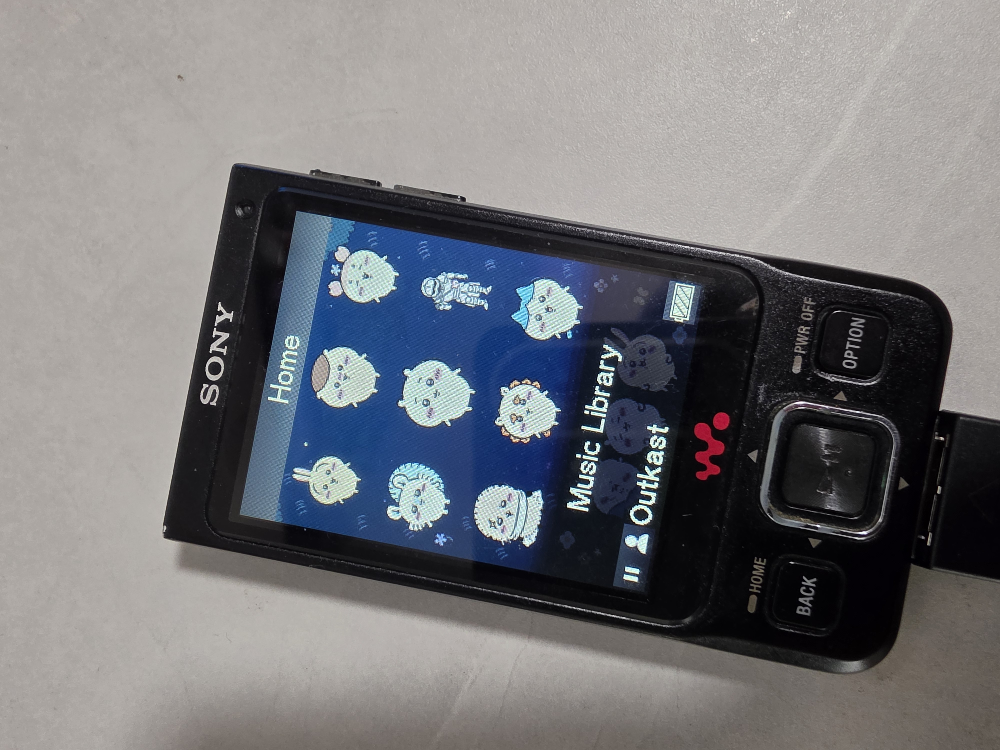
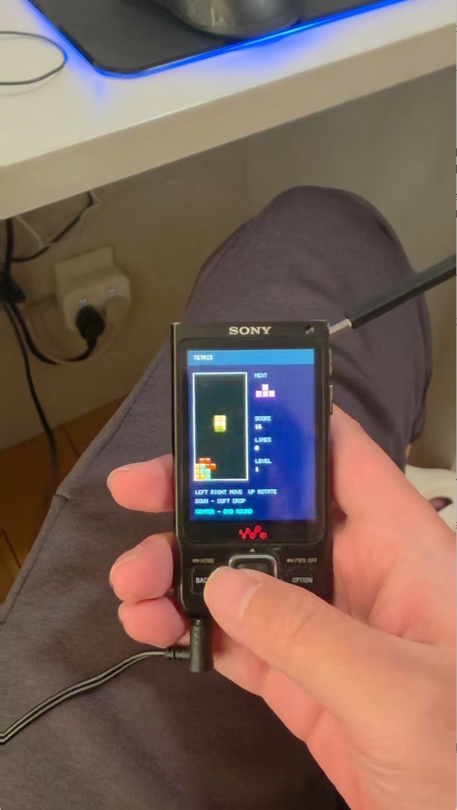

# Sony NW-A910 系列自制固件

[English](README.md) · [简体中文](README.zh-CN.md) · [日本語](README.ja.md)

为日版 Sony NW-A910 系列提供简体中文和英文界面，并记录自制固件的开发方法。

| 英文界面与自定义主题 | 实机运行俄罗斯方块 |
| :---: | :---: |
|  |  |

照片来自此前的 A918 实机版本，当前发布包仍需实机验证。

> **刷机有风险，可能造成数据丢失或设备无法启动。请先备份数据。当前版本仍在实验阶段，详见[风险说明](docs/SAFETY.md)。**

## 项目介绍

我们从索尼原版固件入手，解开升级包，找到界面程序和资源，补齐中英文翻译，再重新打包。奇卡哇主题和游戏入口是两个定制示例，分别展示如何修改界面、运行自制程序。

本工程只是抛砖引玉。这些方法也可供其他 Sony NW 型号的固件开发参考，但不同型号的系统、密钥和硬件可能不同，需要分别研究。

原厂资源包含英语、日语、法语、德语、意大利语、西班牙语、简体中文、繁体中文、俄语、韩语和葡萄牙语，共 11 种语言。我们完成了中英文补译；其他语言的编号和资源结构也已整理，方便继续开发。

## Rockbox 与致谢

本工程能解开索尼升级包，离不开 [Rockbox](https://www.rockbox.org/) 对 Sony UPG 格式的研究。我们使用它的 [upgtools](https://github.com/Rockbox/rockbox/tree/master/utils/nwztools/upgtools) 搜索这份固件的 DES 等效密钥，解包和重新打包，并独立校验修改后的固件。

中英文本地化、资源替换和自制程序在索尼原系统上实现；本工程没有安装 Rockbox 系统。相关工具源码及说明保留在 `third_party/rockbox-upgtools/`。

## 使用与兼容性

固件基于索尼 A910 1.03。目前只有 NW-A918 有实机测试记录，NW-A916／NW-A919 尚未验证。早期中英文界面和主题修改已在 A918 上运行；当前包含游戏入口的版本尚未完成实机验证。

CI 分别生成简体中文版（`zh-CN`）和英文版（`en`）。每份固件使用一种语言，不能在设备上切换。当前安装包包含示例主题和游戏入口；游戏 ROM 需要自行准备。

## 开发文档

[技术文档](docs/TECHNICAL.zh-CN.md)介绍固件解包、语言资源、图标和背景替换、程序运行、容量检查及重新打包的方法，并列出源码位置、关键地址和已知问题。

[构建说明](docs/BUILD.md)介绍开发环境与 GitHub Actions。[程序接口](docs/APPS.md)说明自制程序如何启动、读取文件和退出。

## 构建

安装依赖后，在工程根目录依次运行：

```sh
python scripts/build_release.py --language zh-CN
python scripts/build_release.py --language en
```

安装包输出到 `dist/<VERSION>/<language>/`，包含索尼更新程序、固件、示例程序、源码和校验报告，不包含商业游戏 ROM 和初始化存档。

GitHub Actions 会检查推送和 PR。推送与 [VERSION](VERSION) 一致的 `v<版本>` 标签，或手动请求发布，可在构建通过后创建草稿预发布。

## 目录

- `scripts/`：固件分析、构建和校验工具。
- `translations/`：中英文补译。
- `assets/patches/`：对原版固件的修改。
- `games/`：自制程序示例。
- `docs/`：技术文档；`docs/archive/` 保存历史调查。
- `work/`：临时文件；`dist/`：构建结果，均不提交到 Git。

工程版本由 [VERSION](VERSION) 管理，设备显示的索尼固件版本仍为 1.03。第三方代码和素材的说明见 [THIRD_PARTY](THIRD_PARTY.md)。
